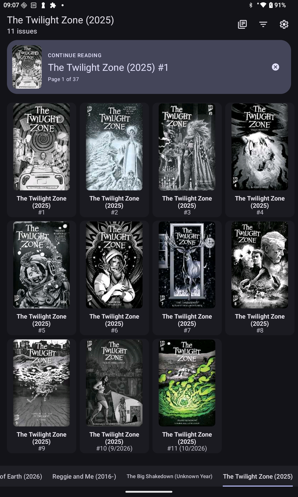
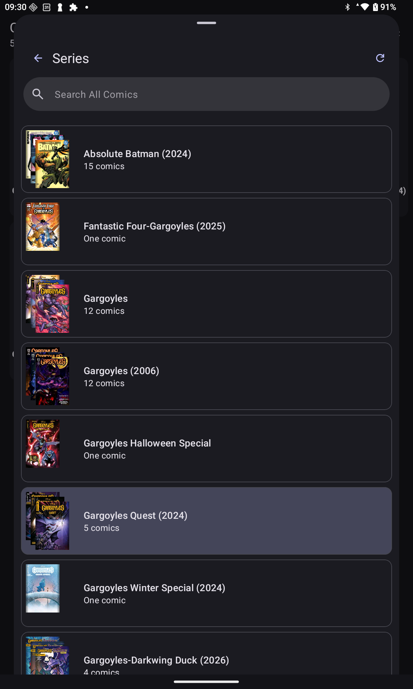
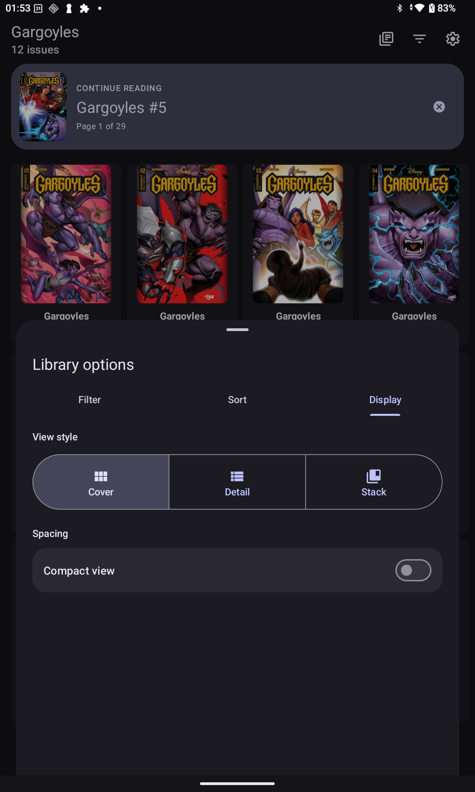
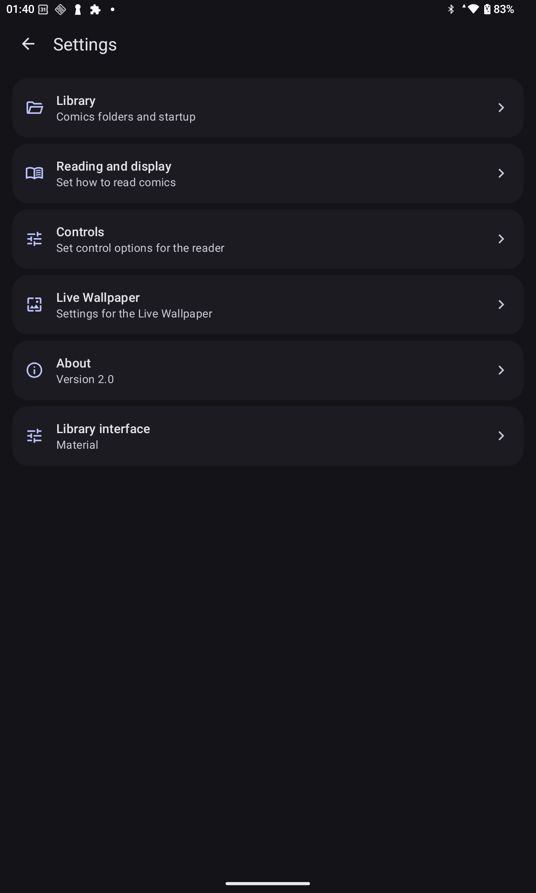
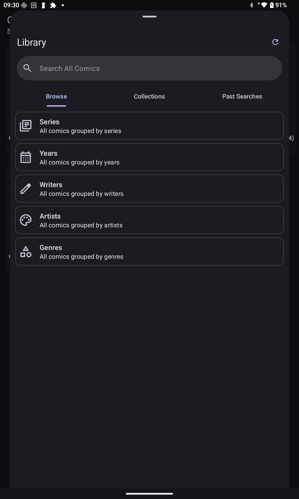
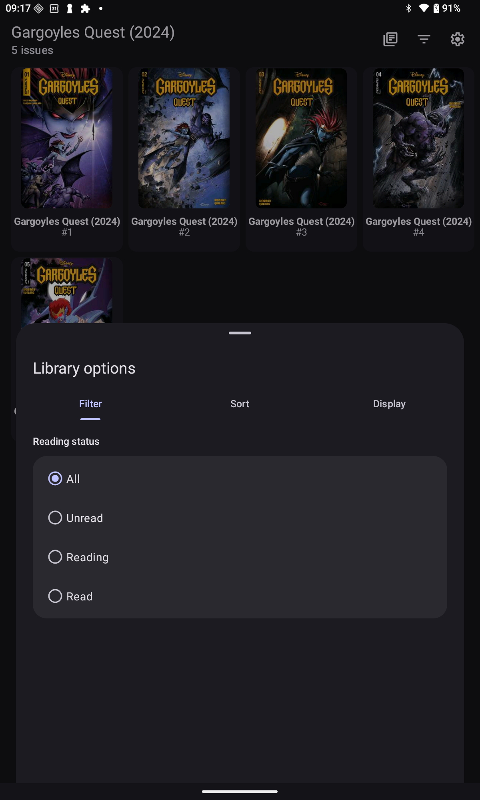

# ComicRack SP for Android

**SP means “Slop.”** ComicRack SP is an AI-assisted effort to decompile and update ComicRack 1.80 for Android. AI helped reconstruct Java from the original bytecode and modernize the library, settings, and file handling.

## Screenshots

Captured from the Android tablet build. Comics shown are example library content and are not included with the app.

| Material library | Series browser |
| --- | --- |
|  |  |
| **Library options** | **Settings** |
|  |  |
| **Browse categories** | **Reading status** |
|  |  |

## What changed

Current app version: **2.0**.

- Updated for modern Android. ComicRack SP targets Android API 37 and requires Android 8.0 or later.
- Use Android’s file picker to select your main comics folder, add a second folder in Settings, or open an individual comic. The library only needs read access to scan and open your comics.
- The library opens in Material 3 by default, with a **Collections** toolbar button, a **Continue Reading** card that shows the cover, issue number, and saved page, and a **Library options** bottom sheet with **Filter**, **Sort**, and **Display** tabs. Choose **Settings → Library interface → Classic** for the original library layout. Both layouts share your library and reading progress. Swiping between collections updates the toolbar title and issue count. Material collection tabs appear at the bottom while swiping, support tapping to switch collections, and hide after about three seconds of inactivity.
- Settings groups library folders, reading and display, controls, and live wallpaper in one place.
- The library shows saved entries while it checks for file changes in the background. Covers are cached for reuse across launches.
- Read CBZ and CBR comics with page transitions and a next-page preview while dragging.
- Fresh installs skip the About and Terms dialogs. Automatic usage-statistics and finished-comic rating prompts are disabled; manual comic ratings remain available. The empty-library prompt uses the Material theme. About is available in Settings, with Material About and History tabs. Twitter integration has been removed.

## Getting started

Choose **Select folder** when prompted and pick the folder that contains your comics. ComicRack scans its subfolders too. Use **Refresh library** after adding or removing files if you want to update the list immediately. To read a comic outside your library, open it from Android’s file manager and choose ComicRack SP.

Open **Library options** from the toolbar to filter by reading status with a single-choice radio list, change sorting and direction, or choose Cover, Detail, and Stack with icon buttons. Compact view and stack grouping are available in Display. Drag the sheet upward for more room. Use the Settings icon for folders and app preferences. Dismiss Continue Reading with its X button or by swiping the card left or right. It stays hidden across restarts until you open another comic.

Open **Collections** from the Material toolbar to choose a collection or browse categories. Each Browse category has its own Material icon; collections and series show stacked cover previews. Drag the sheet upward for more room; its list scrolls below the fixed search and navigation controls. Search your whole library from the field above the tabs; **Past Searches** keeps your recent queries for reuse. **Clear search** takes you back to **All comics** without deleting your history. Dismiss the sheet by swiping down, tapping outside it, or pressing Back. The Material library no longer uses a drawer or pin control; Classic retains sidebar pinning where its layout supports it.

Manual library refresh shows scan progress and offers Retry if it fails. Startup checks continue quietly in the background.

Wi-Fi sync is outside the current storage update and is not yet verified with Android document folders. RAR5 compatibility is also unverified.

[Developer handoff](docs/README.md)
